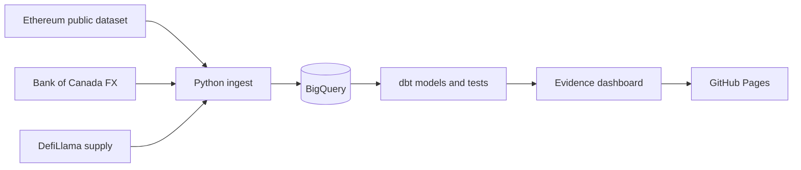

# Non-USD Stablecoin Analysis

**Are Canadian stablecoins actually being used?** I built a daily pipeline on public on-chain data to find out, and to compare them with other non-USD stablecoins.

**[View the live dashboard](http://insightsanalytics.info/Non-USD-Stablecoin-Analysis/)**

## What I found

Not much, so far, but the newest coin is already the most used and this isn't much of a surprise given that regulations are still being ironed out. I started this project about 2 weeks before Wealthsimple announced their support of CADD in their new product launch presentation and I'll certainly be updating in the future to observe uptake in their user base. Figures are as of 2026-11-07, and weekly figures are for the week of 2026-10-26.

1. **CADD leads on usage despite being the newest.** It launched on 2026-05-04 and had 66 active addresses on Ethereum in the week, against 14 for CADC and 4 for QCAD. It's still early: five wallets hold 85.5% of its Ethereum balance.
2. **Supply isn't usage.** QCAD has about $2.5M CAD in circulation, nearly all on Ethereum, but it moved just 5 times in the week.
3. **The Canadian market is tiny next to its peers.** CADD, QCAD and CADC total about $8.0M CAD, roughly 1% of EURC's $727M. EURC had 6,046 active addresses in the same week.
4. **Base is where much of the supply now sits.** It holds half of CADD and 59% of CADC. This project only loads transfers from Ethereum, so usage of both is understated.

## How it works



GitHub Actions runs the pipeline every morning, tests the data, then rebuilds the site. If the pipeline fails, the last good site stays up.

## Engineering decisions

- **A contract registry instead of token symbols.** The public token list has about 100 contracts using the EURC symbol alone, so ingestion filters by address, never by symbol. [`token_contracts.csv`](transform/seeds/token_contracts.csv) also records which contracts count toward supply.
- **INSERT instead of MERGE.** The Ethereum load has a 10 GB bytes cap, and it rejected the first scheduled runs. BigQuery estimated a MERGE at 1,045 GB, even with a date filter, against 4.2 GB for an `INSERT ... WHERE NOT EXISTS`. The load is now an INSERT that skips rows already loaded, so re-runs never duplicate data.
- **Data tests that caught real issues.** A test that supply never goes negative exposed A7A5 burning more than it had minted. That led to finding that its supply changes outside standard events, so it now comes from DefiLlama ([#17](https://github.com/SeanC66/Non-USD-Stablecoin-Analysis/issues/17)). A supply check against Etherscan found BRZ exactly 150M too high, from a 2019 contract now left out of supply ([#16](https://github.com/SeanC66/Non-USD-Stablecoin-Analysis/issues/16)).
- **Spam filtered out of usage.** Anyone can send a zero-value transfer to any wallet, and 11.4% of EURC's addresses appear in nothing else. They don't count as active addresses, which keeps the comparison between coins fair.
- **No stored keys.** GitHub Actions signs in to Google Cloud with Workload Identity Federation, which trusts only this repository.

## Limitations

- **Transfers are Ethereum only.** Base is deferred until there's a data source that doesn't need a paid RPC plan ([#10](https://github.com/SeanC66/Non-USD-Stablecoin-Analysis/issues/10)). Supply covers more chains through DefiLlama, but activity doesn't.
- **A7A5's supply is external.** It comes from DefiLlama rather than on-chain events, and A7A5 mainly circulates on Tron, so its Ethereum activity is a partial view.
- **The rouble rate has stopped.** The Bank of Canada stopped publishing it after 2026-04-30. `mart_daily_supply` carries the last rate forward and sets `fx_is_stale` once it's more than 7 days old, so treat A7A5's CAD value from 2026-05-08 onward with caution.
- **Supply jumps when its source changes.** Headline supply moves from Ethereum to all chains on each coin's first DefiLlama day, which isn't real growth. For CADD that day is its launch day, so the dashboard's launch chart uses Ethereum alone.
- **The dashboard is pinned to Evidence 40.1.8.** It's the last release that builds a static site, so it won't get updates.

The dashboard's [Data notes](http://insightsanalytics.info/Non-USD-Stablecoin-Analysis/data-notes/) page has more detail.

## How to run it

You'll need Python 3.12, Node 22 and a Google Cloud project. [`docs/gcp_setup.md`](docs/gcp_setup.md) covers the cloud setup, and [`backfill/`](backfill/) loads Ethereum history before the first run.

```bash
gcloud auth application-default login
pip install -r requirements.txt

# Load the latest data
python -m ingest ethereum boc defillama

# Build and test the models
cd transform
cp profiles.example.yml profiles.yml
DBT_PROFILES_DIR=. dbt deps
DBT_PROFILES_DIR=. dbt build

# Preview the dashboard
cd ../reports
npm ci
npm run sources
npm run dev
```

Unit tests run with `pytest`.
